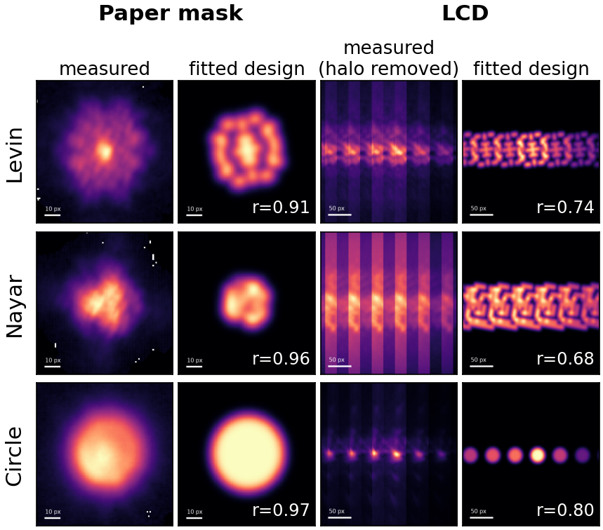
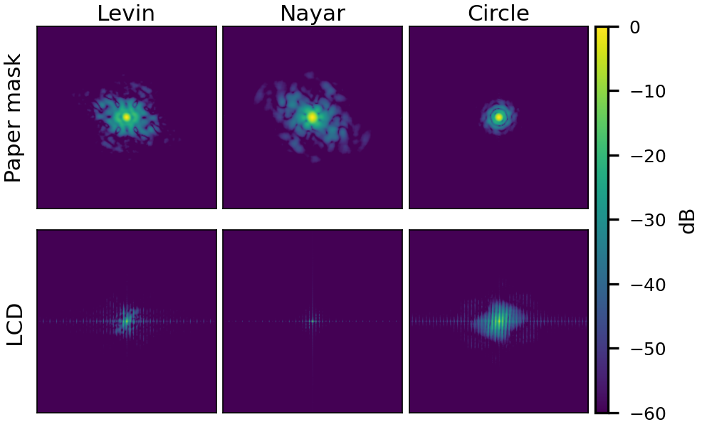
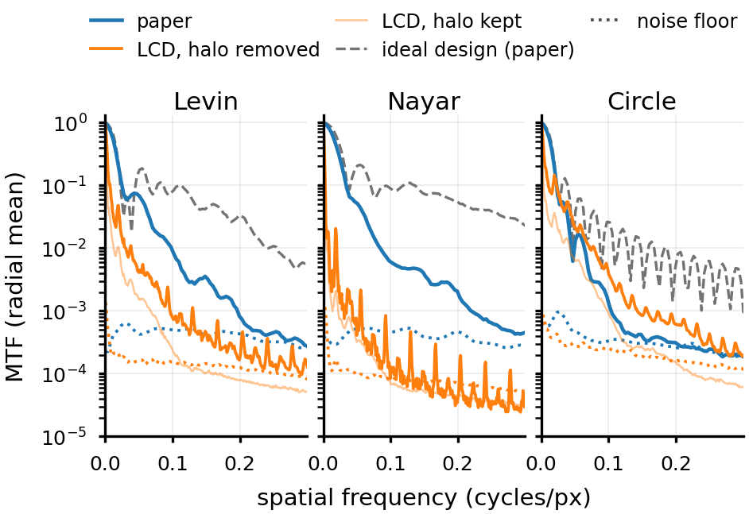
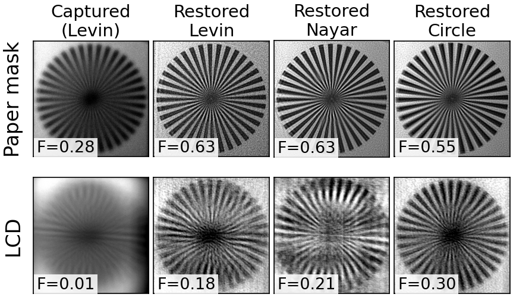
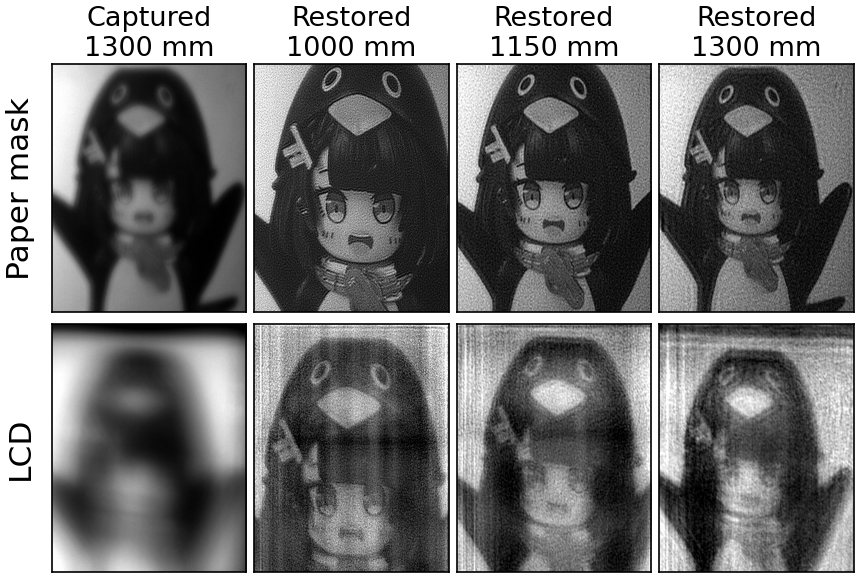
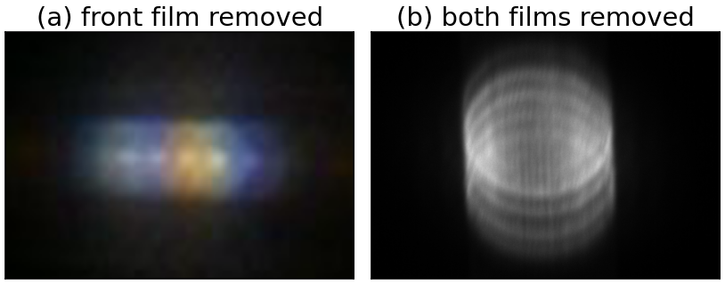

# Outputs

The results shown in the report, with the figure and table numbers used there. The report figures are in [`report_figures/`](report_figures). The full-size per-aperture versions and the numbers behind the tables are in [`psf_mtf/`](psf_mtf) and [`deconvolution/`](deconvolution).

All results are at 1300 mm unless stated otherwise. Each one compares the three apertures (Levin, Zhou–Nayar and Circle), cut as paper masks and shown on the LCD.

---

## Figure 4 – Point spread functions

Each measured PSF (10-frame registered mean) beside its fitted design, with their correlation *r*. The paper-mask PSFs are blurred copies of their patterns (*r* = 0.91–0.97). The LCD PSFs are a horizontal chain of pattern copies from the pixel grid, shown here after the background halo has been removed (*r* = 0.68–0.80).

Full four-panel version for each aperture: [`psf_mtf/paper_*.png`](psf_mtf) and [`psf_mtf/lcd_*.png`](psf_mtf).

## Figure 5 – 2D MTF

The magnitude of the Fourier transform of each PSF, 20 log₁₀|H| in dB, over ±0.5 cycles/pixel.

## Figure 6 – Radial MTF

The radial mean of each MTF, one panel per pattern. Each panel shows the paper mask, the LCD with and without its halo, the ideal paper design, and the measured noise floor of each 10-frame mean.

All six on one plot: [`psf_mtf/mtf_all.png`](psf_mtf/mtf_all.png).

## Table 1 – PSF, MTF and Siemens star results

Per aperture: exposure, frame drift, fitted design scale, design correlation, halo share, PSF MTF50 and MTF10, where the MTF reaches the noise floor, and ring fidelity *F* of the Siemens star before and after deconvolution.

- PSF and MTF values: [`psf_mtf/psf_mtf.json`](psf_mtf/psf_mtf.json) (summary in [`psf_mtf/RESULTS.md`](psf_mtf/RESULTS.md))
- Ring fidelity *F*: [`deconvolution/summary.csv`](deconvolution/summary.csv) (summary in [`deconvolution/TABLES.md`](deconvolution/TABLES.md))

## Figure 7 – Siemens star

The 36-spoke Siemens star through the paper mask (top) and the LCD (bottom). Each row shows the captured star and the Wiener-restored star for each pattern, with ring fidelity *F* (0 = no spokes, 1 = a perfect star).

Full-frame images: `deconvolution/<aperture>/images/star_captured.png` and `star_restored.png`.

## Table 2 – LCD processing steps

Ring fidelity *F* of the LCD star after each processing step: green channel from one frame, 10-frame mean, per-colour PSFs, edge handling, and a total-variation prior.

Values: `deconvolution/lcd_*/summary.json`, summarised in [`deconvolution/TABLES.md`](deconvolution/TABLES.md).

## Figure 8 – Natural scene

A natural scene through the Levin aperture: captured at 1300 mm, and restored at 1000, 1150 and 1300 mm, each with the PSF measured at that depth.

Full-frame captured and restored images at each depth: `deconvolution/paper_levin/images/` and `deconvolution/lcd_levin/images/`.

## Figure 9 – LCD polarising films

A point source through the LCD with (a) the front polarising film removed and (b) both films removed.

---

In `deconvolution/`, `<aperture>` is one of `paper_levin`, `paper_nayar`, `paper_circle`, `lcd_levin`, `lcd_nayar` or `lcd_circle`.
