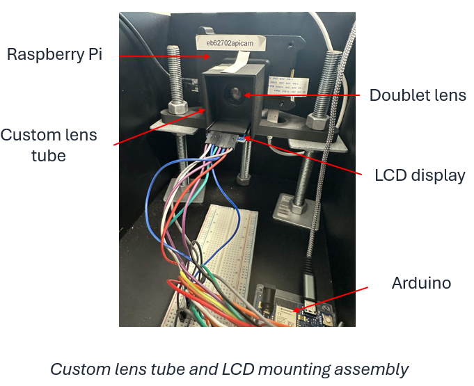
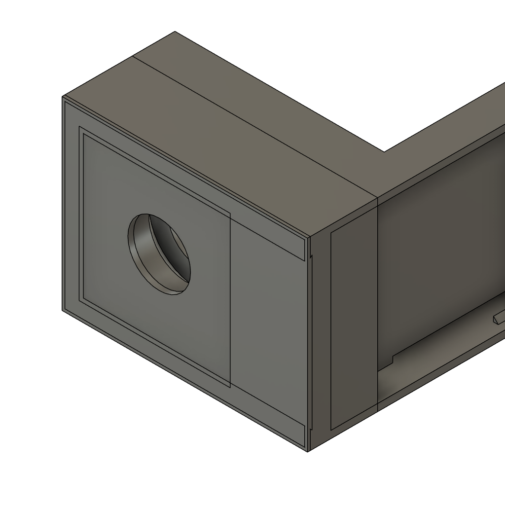
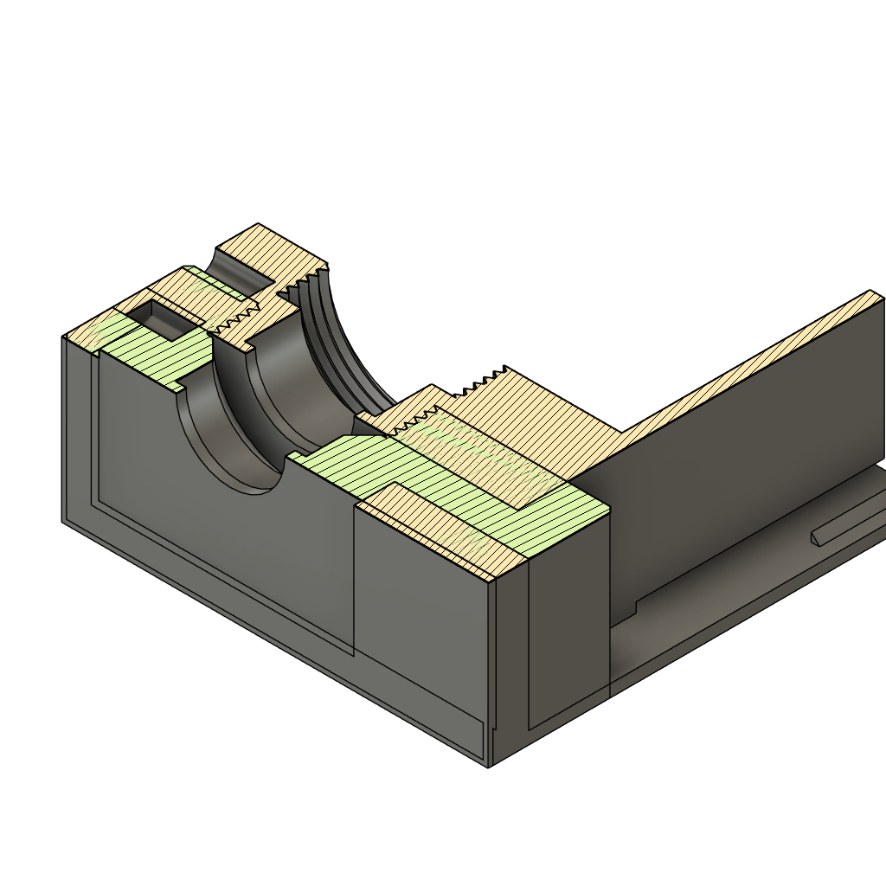
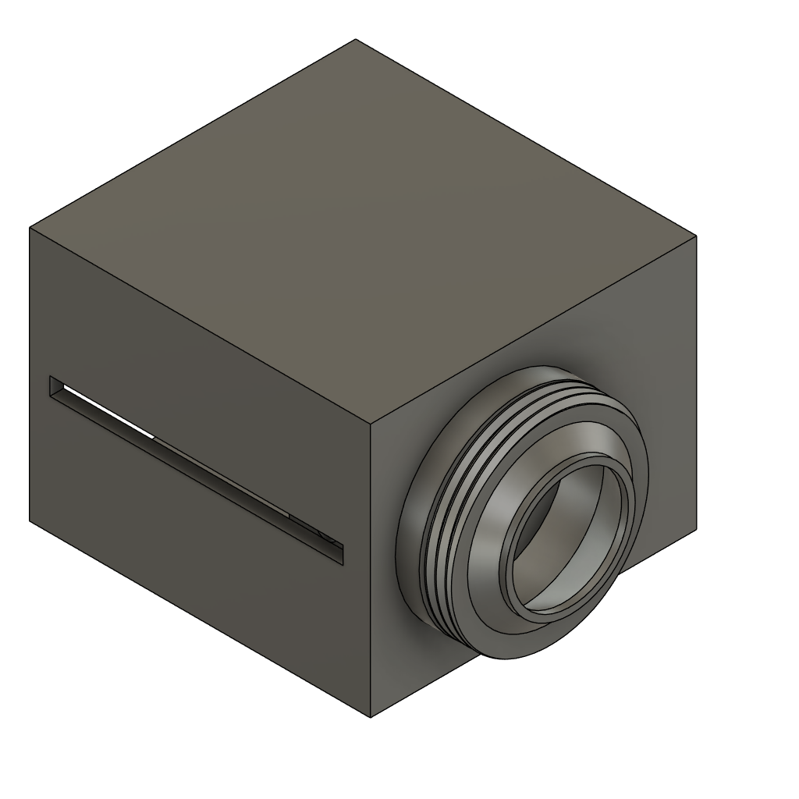
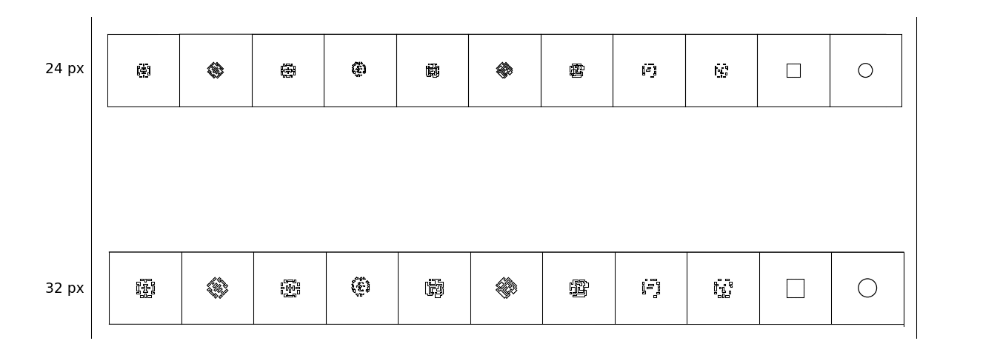
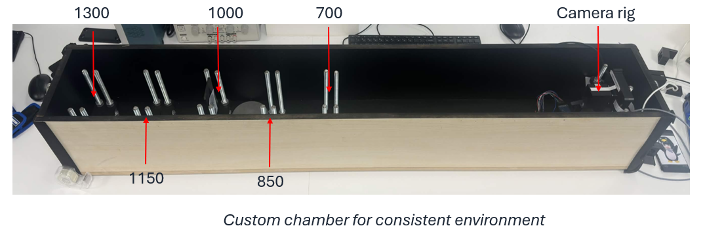

# Physical Structure

This folder contains everything needed to build the hardware: the 3D printed camera parts, the laser-cutting files for the paper masks, and the details of the test chamber.

  

---

## Contents

| Folder / file | What it is |
|---|---|
| [`CAD/`](CAD) | Fusion 360 source files for the 3D printed lens holders and lens tube |
| [`DXFs/`](DXFs) | Laser-cutting files for the paper aperture masks |

---

## 3D printed parts (`CAD/`)

The camera is a Raspberry Pi camera module with a doublet lens, and the aperture (either the LCD or a paper mask) sits directly behind the lens. No off-the-shelf mount holds a flat display at the aperture of a Raspberry Pi lens, so these three parts were designed and printed.

  
  
  

<em>Left to right: LCD and lens holder, cross-section showing the slot behind the lens, lens tube.</em>

| File | Part | Purpose |
|---|---|---|
| `LCD_Lens_Holder.f3d` | LCD and lens holder | Attaches to the Raspberry Pi camera mount. A threaded bore carries the doublet lens, and a thin slot directly behind the lens holds the 1.9 mm thick LCD at the aperture plane. The slot is sized to the panel, so it returns to the same position and orientation every time it is inserted. |
| `Mask_Lens_holder.f3d` | Paper-mask holder | The same holder, with a slot for the paper masks instead of the LCD. A mask sits in the same position as the LCD, so swapping between them does not move the lens or the sensor. |
| `Lens Tube.f3d` | Lens tube | Fits around the holder and encloses the optical path to block stray light, with a side slot for inserting the aperture. |

To open a file in Autodesk Fusion, choose **File → Open → Open from my computer**. To print a part, right-click its body, choose **Save as Mesh**, export as STL or 3MF, and slice it as normal.

**Assembly**

1. Screw the doublet lens into the threaded bore of the holder, convex side facing the scene (this minimises spherical aberration).
2. Attach the holder to the Raspberry Pi camera mount.
3. Slide the LCD (or a paper mask in the mask holder) into the slot behind the lens.
4. Fit the lens tube over the assembly.

---

## Paper aperture masks (`DXFs/`)

Each paper mask matches the outer size and feature spacing of the same pattern displayed on the LCD, so the two can be compared directly. Because the LCD pixels are not square, the patterns are slightly taller than they are wide.

Each DXF is one cutting sheet with two rows of 11 apertures, one row per size, with the smaller size on top. Each aperture sits in its own square frame so it can be cut out and fitted to the mask holder. Each row holds nine coded patterns, then an open square and a circle. The coded patterns include the Levin and Zhou–Nayar designs used in the experiments, plus rotated and alternative patterns that were not tested.

  

<em>The <code>32_and_24_masks.DXF</code> sheet: 24-pixel apertures (top row) and 32-pixel apertures (bottom row).</em>

The DXF files are named by the two pattern sizes they contain. The size is given as a width in LCD pixels and as physical dimensions:

| LCD pixels | Physical size (mm) | File |
|---|---|---|
| 12 | 2.375 × 2.508 | `16_and_12_masks.DXF` |
| 16 | 3.125 × 3.3 | `16_and_12_masks.DXF` |
| **24** | **4.75 × 5.016** | `32_and_24_masks.DXF` |
| 32 | 6.25 × 6.6 | `32_and_24_masks.DXF` |
| 48 | 9.5 × 10 | `64_and_48_masks.DXF` |
| 64 | 12.50 × 13.20 | `64_and_48_masks.DXF` |

**The 24-pixel masks were the ones used in the experiments**, in three patterns:

- **Levin:** coded pattern from Levin et al., SIGGRAPH 2007
- **Zhou–Nayar:** coded pattern from Zhou and Nayar, ICCP 2009
- **Circle:** an ordinary round aperture with the same open area as the Zhou–Nayar pattern

The other sizes and patterns are included for anyone who wants to test larger or smaller apertures or different designs.

**Cutting**

- Material: 80 gsm black Quill paper
- Machine: Epilog Fusion M2 CO₂ laser cutter
- Import the DXF at 1:1 scale (millimetres). Check one cut mask with calipers against the table above before cutting the rest.

---

## Test chamber

All captures were taken inside an enclosed chamber so that every capture uses the same geometry and stray light is blocked.

  

- Matte black interior and a latched lid to block stray light
- Camera rig fixed at one end
- Targets (point source, Siemens star or natural scene) screw onto fixed posts at **700, 850, 1000, 1150 and 1300 mm** from the camera
