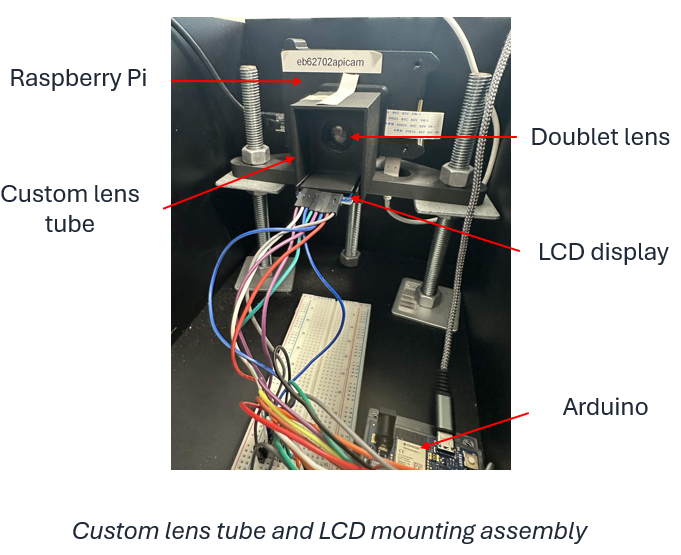
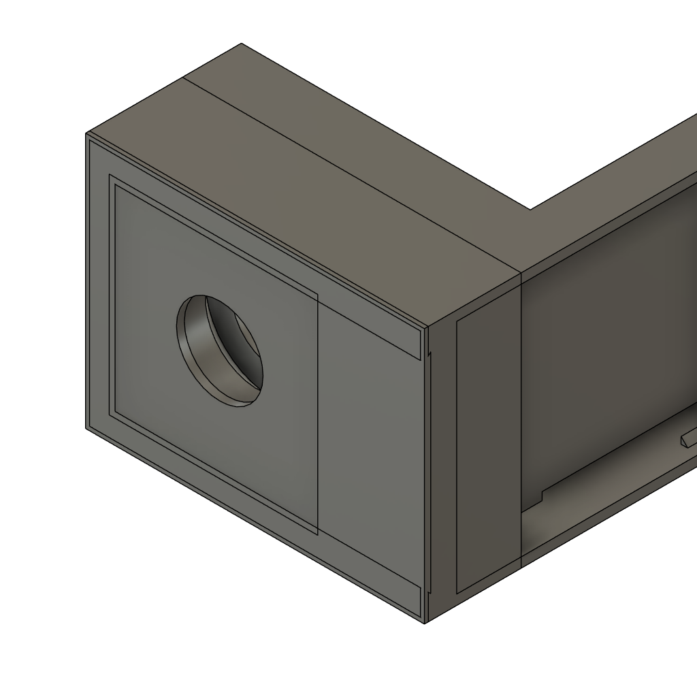
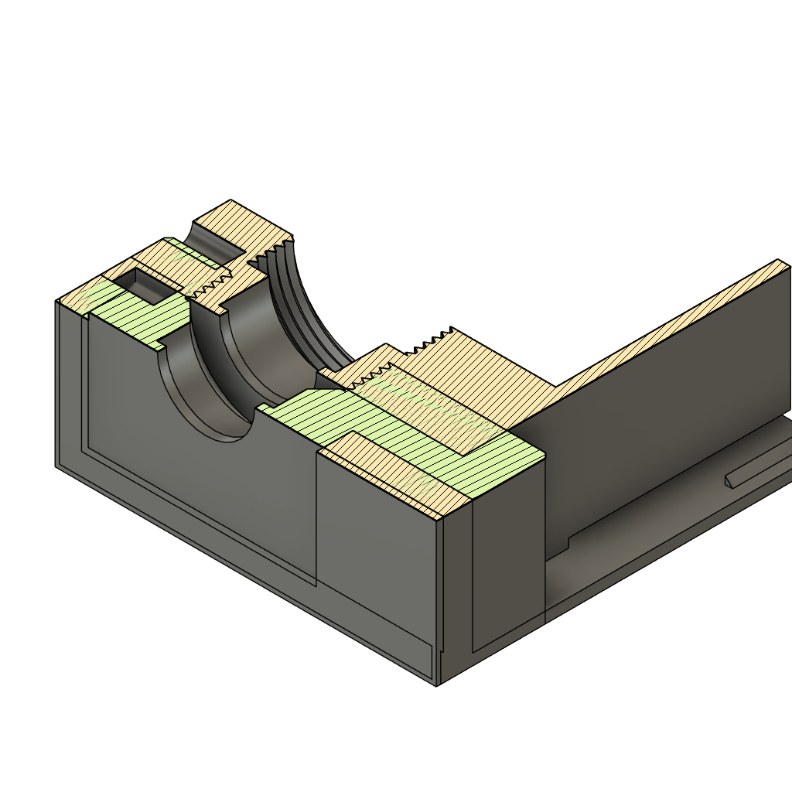
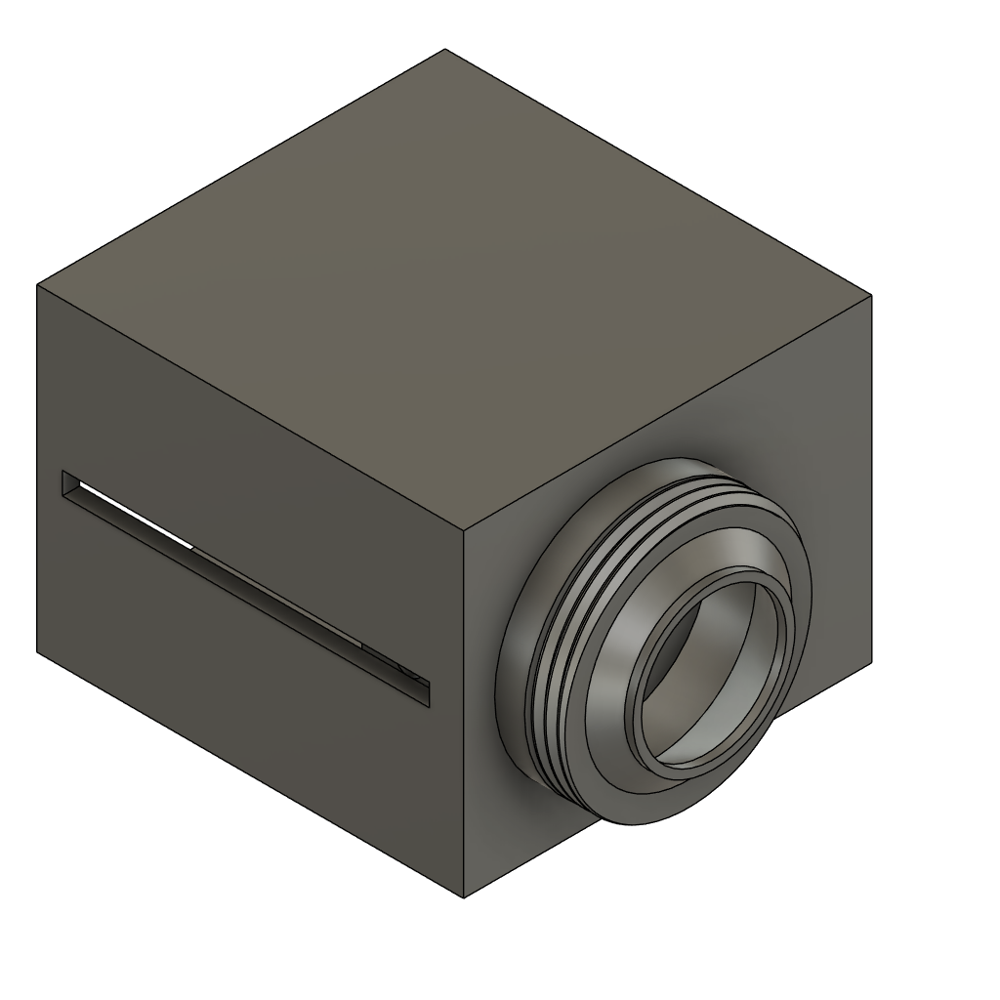
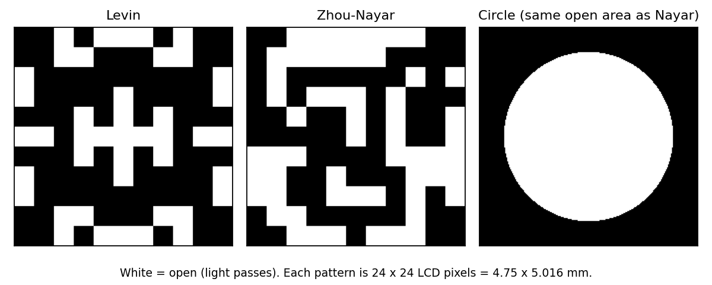
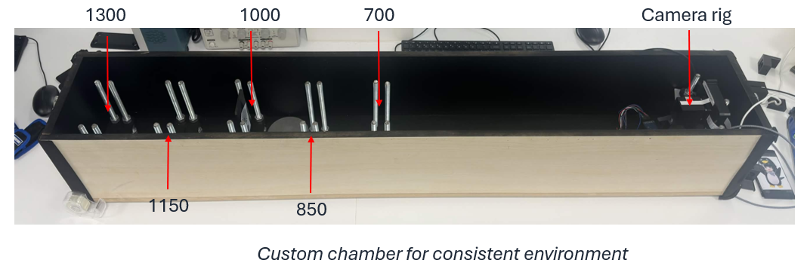
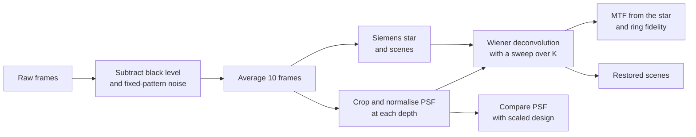

# MECH5720 2026: Transparent LCD as a Programmable Coded Aperture

**Group 13 – Aperture Laboratories:**  Michael Delano, Devagya Budhiraja, Minh Bao, Peter Cruz, Ethan Duong

A coded aperture is a patterned mask placed inside a camera lens so that blurred images can be sharpened afterwards by computation. A cut mask is fixed, changing the pattern means opening the camera and fitting a new mask. 

In this project we placed a transparent LCD at the aperture of a camera so the pattern can be changed in software. We then compared it directly against laser-cut paper masks of the same size, in the same camera and the same test chamber.

This repository contains the hardware files, the raw captures and the processing code needed to rebuild the system and repeat the experiment.

## Contents

- [What we built](#what-we-built)
- [Aperture patterns](#aperture-patterns)
- [Test chamber](#test-chamber)
- [Capture procedure](#capture-procedure)
- [Processing pipeline](#processing-pipeline)
- [Repository layout](#repository-layout)


## What we built

The camera is a Raspberry Pi camera module with a doublet lens. A 1.4 inch a-TFT LCD panel (ST7735S controller) sits directly behind the lens, at the aperture plane. We removed the panel's backlight so it is transparent: undriven pixels let light through and driven pixels turn dark. An Arduino stores the patterns and drives the panel, so the aperture can be switched without touching the optics.

<p align="center">
  
</p>

No off-the-shelf mount holds a flat display at the aperture of a Raspberry Pi lens, so we designed and 3D printed our own parts:

- **Lens and LCD holder:** attaches to the camera mount and carries the doublet lens in a threaded bore. A thin slot directly behind the lens holds the 1.9 mm thick LCD at the aperture plane, in the same position every time it is inserted.
- **Lens tube:** encloses the optical path and has a side slot for inserting the aperture.
- **Paper-mask holder:** carries a paper mask into the same slot, so swapping between the LCD and a mask does not move the lens or the sensor.

<p align="center">
  
  
  
</p>
<p align="center"><em>Left to right: lens and LCD holder, cross-section showing the LCD slot, lens tube.</em></p>

## Aperture patterns

We tested three patterns, each shown on the LCD and cut as a matching paper mask:

- **Levin:** a coded pattern designed for deblurring and depth estimation (Levin et al., SIGGRAPH 2007).
- **Zhou–Nayar:** a coded pattern designed for deblurring (Zhou and Nayar, ICCP 2009).
- **Circle:** an ordinary round aperture with the same open area as the Zhou–Nayar pattern, used as the conventional baseline.

<p align="center">
  
</p>

Each pattern is 24 × 24 LCD pixels, which is 4.75 × 5.016 mm (the LCD pixels are not square). The paper masks have the same outer size and feature spacing. 

They were laser cut from 80 gsm black Quill paper on an Epilog Fusion M2 CO₂ laser cutter. The cutting files are in [`Physical Structure/DXFs`](Physical%20Structure/DXFs), including larger and smaller versions that we did not test.

## Test chamber

All captures were taken inside an enclosed chamber with a matte black interior and a lid to block stray light. The camera rig is fixed at one end. Targets (point source, Siemens star or natural scene) screw onto fixed posts at 700, 850, 1000, 1150 and 1300 mm, so every LCD and paper-mask capture uses the same geometry.

<p align="center">
  
</p>

## Capture procedure

We followed the same procedure for all six apertures (three patterns, each on the LCD and as a paper mask). The camera was focused closer than the targets, so every target is out of focus and its blur is a measurable copy of the aperture.

| Step | What we captured |
|---|---|
| Dark frame | Frames with the lens covered, to remove the sensor black level and fixed-pattern noise |
| Lens reference | A Siemens star at 1000 mm with no aperture fitted, in focus |
| Point spread function (PSF) | A point source at 1000, 1150 and 1300 mm, plus the four corners of the frame at 1300 mm |
| Siemens star | A 36-spoke star at 1300 mm |
| Natural scenes | Two printed scenes at 1000, 1150 and 1300 mm |

Every target was captured as 10 frames, saved as both DNG and 16-bit linear PNG. Analogue gain was 1 and auto-exposure was off. The LCD's polarisers absorb a lot of light, so it needed longer exposures than the paper masks:

| | Paper mask | LCD |
|---|---|---|
| PSF | 500 µs | 60 000 µs |
| Siemens star and scenes | 64 000 µs | 60 000 – 256 000 µs |

Capture folders are named by aperture, target and settings. For example, `LCDLevinPSFG1E60000D1000` is the LCD showing the Levin pattern, a PSF capture, gain 1, exposure 60 000 µs, at 1000 mm.

## Processing pipeline



1. **Pre-processing:** subtract the black level and fixed-pattern noise, then average the 10 frames of each capture.
2. **PSF calibration:** crop each point-source capture and normalise it to sum to one. This gives the measured PSF at each depth, with every real imperfection of the aperture included.
3. **Design comparison:** fit a scaled copy of each designed pattern to its measured PSF.
4. **Deconvolution:** restore the star and scenes with a Wiener filter, using the PSF measured at the same depth, and sweep the regularisation constant *K*. The paper masks use the green channel; for the LCD we also tested frame averaging, per-colour PSFs, edge handling and a total-variation prior.
5. **Evaluation:** measure the MTF from the Siemens star (contrast around circles of known spatial frequency), score each restored star by its correlation with an ideal star (ring fidelity), and restore the natural scenes for visual comparison.

The imaging model behind this is the standard defocus model: the captured image is the sharp scene convolved with the PSF plus noise, `y = h * x + n`, and the Wiener filter `W = H* / (|H|² + K)` inverts it in the frequency domain.


## Repository layout

```
Aperture-Laboratories-/
├── Captures/             Raw captures (DNG + PNG) for every aperture, target and distance
├── Code/                 Processing and analysis code
├── Physical Structure/   Chamber details, LCD and mask holders, mask DXF files
│   └── DXFs/             Laser-cutting files for the paper masks (12–64 pixel sizes)
└── docs/images/          Images used in this README
```
